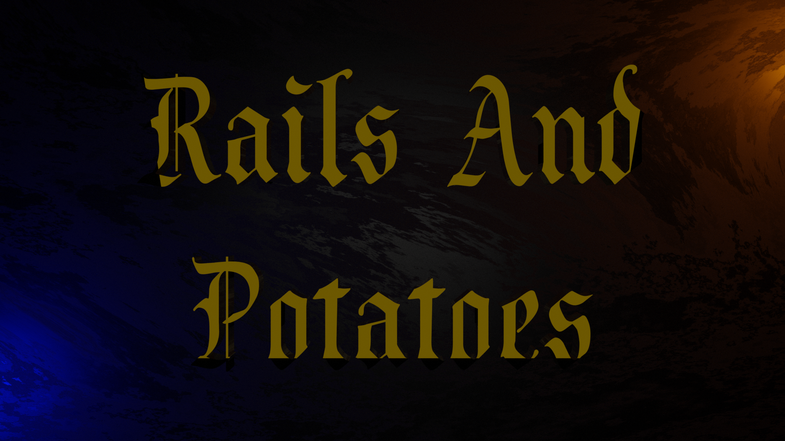

<p align="center">
  <a href="" rel="noopener">
 </a>
</p>

<div align="center">

[](https://www.python.org/)
[](https://www.pygame.org/)

</div>

--- 

This was a game I tried to create at the age of 14. I never finished it, but it does show some fun stuff I created. :)

## 📝 Table of Contents

- [About](#about)
- [Getting Started](#getting_started)
- [See More](#see_more)
- [Authors](#authors)
- [Want To Help?](#help)
- [Report Bugs](#bug)

## 🧐 About <a name = "about"></a>


<br>
<br>
<h2>🏁 Getting Started <a name = "getting_started"></a></h2>

- ###         get the game:

    first go to the [Download Page]()

    - Windows:
      download the windows version

    - macOS:
      download the mac version

    - linux:
      download the source code and [python for linux](https://www.python.org/downloads/source/) and run the   python code by opening the terminal in the folder of the game and type:
      ```
      python Rails_And_Potatoes.py
      ```
      and press enter

- ###         get the source code and run it:

    first go to the [Download Page]() and download the source code.
    go to the python download page and download [python](https://www.python.org/downloads) for your os.
    install python and unzip the source code.
    open the terminal(or the command line) in the folder of the source code and type:
    ```
    python Rails_And_Potatoes.py
    ```
    and press enter.

  #### Enjoy The Game!